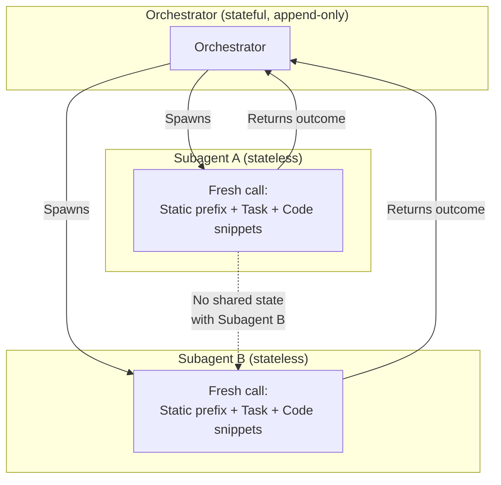
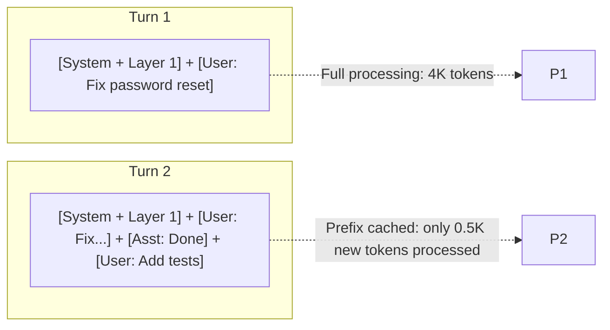

# Autonomous Coding Agent — Architecture Design

## Overview

An autonomous coding agent that maintains full project context (goals, progress, decisions, codebase knowledge, and past interactions) across sessions.

ACA lives in a monorepo at `src/aca/`. Shared infrastructure (config, LLM client, conversation state, tool framework) is in `src/core/` and imported by ACA. Other agents (e.g., a general assistant in `src/assistant/`) share the same core library but never import from each other.

Four core principles:

1. **The Orchestrator stays light** — it does not load the world. It knows where to find things and routes context to subagents.
2. **Memory is a retrieval system, not a preload system** — layers are queried via tools on-demand, never preloaded into the prompt.
3. **Prompt caching is maximized** — static prefix (system prompt, tools, Layer 1) is identical across turns and subagents. Dynamic context is append-only or retrieved via tools.
4. **Subagents are stateless** — spawned fresh with scoped context bundles. Internal history is discarded after returning outcomes.

---

## 1. Invocation & Action Model

### Invocation Model

- **Phase 1:** On-demand CLI endpoint (current focus — task IS the user's prompt)
- **Phase 2:** Long-running daemon that listens for triggers (git hooks, scheduled tasks, user requests)
- **Future:** VS Code extension

### Action Model — Trust Tiers

| Tier | Action Class | Policy |
|------|-------------|--------|
| **Tier 1** | Read-only (read files, search codebase, query memory) | Auto-allowed |
| **Tier 2** | Reversible writes (file edits in a git repo) | Auto-allowed with logs |
| **Tier 3** | Irreversible (push, send email, delete, publish) | Require human confirmation |

---

## 2. Persistent Memory: The 5 Layers

All layers are **queried via tools, not preloaded into the prompt**. This is critical for prompt caching — the static system prefix must not change during a session.

### Layer 1: Project Identity

**What:** The project's purpose, architecture, tech stack, conventions, constraints.

**Storage:** Structured Markdown files in `/agent-context/` within the repo.

```
/agent-context/
├── PROJECT.md          # What this project is, goals, stakeholders
├── ARCHITECTURE.md     # High-level design, component map
├── CONVENTIONS.md      # Code style, naming, patterns
├── CONSTRAINTS.md      # Must-not-dos, security rules, deployment rules
└── GLOSSARY.md         # Domain-specific terminology
```

**Anti-bloat:** Each file is kept under a strict size limit (~500-1000 words). The agent is prompted to prune and compress periodically.

**Placement:** **Static prefix of the prompt** — loaded once at session start, never changes within a session. Changes rarely (maybe once a week), enabling cross-session cache reuse.

---

### Layer 2: Outcome Log & Known Gaps

**What:** A log of what was done, known issues, and partial states — NOT a task queue.

In an **on-demand CLI model**, the "current task" IS the user's prompt. There is no standing backlog of assigned tasks. Layer 2 is the **aftermath trail** — it tells the next session "here's what happened and what's left undone."

**Storage:** Structured Markdown (`OUTCOMES.md`) or SQLite.

```markdown
## Recent Outcomes
- 2026-06-14: Added rate limiting middleware (Redis-backed token bucket)
  - Files: src/middleware/rateLimiter.ts, src/config/rateLimiter.ts
  - Status: ✅ Done
- 2026-06-13: Fixed password reset SES integration
  - Files: src/auth/resetPassword.ts
  - Status: ✅ Done
- 2026-06-12: Started email service migration (SendGrid → SES)
  - Files: src/auth/emailService.ts
  - Status: ⚠️ Partially done — templates still on SendGrid

## Known Issues & Gaps
- Email templates not yet migrated to SES (related to outcome from 2026-06-12)
- Rate limiter lacks integration tests
- WebSocket port not yet opened by infra team
```

**Anti-bloat:** Only recent outcomes (last ~15) and active gaps are loaded. Older outcomes are archived. Full history lives in SQLite but is never fully loaded.

**Placement:** Retrieved via `get_recent_outcomes()` tool — NOT in the static prompt prefix. This tool result is appended to conversation history (cache-safe, append-only).

---

### Layer 3: Decision Log (ADR-style)

**What:** Why decisions were made — prevents the agent from undoing deliberate past choices.

**Storage:** Lightweight Architecture Decision Records in `/agent-context/decisions/`.

```markdown
# Decision 001: Use PostgreSQL over MongoDB

## Context
Need a database for user data, orders, and inventory.

## Decision
Use PostgreSQL.

## Rationale
- Data is inherently relational
- ACID compliance required for payment transactions
- Team has more Postgres experience

## Alternatives Considered
- MongoDB: rejected due to lack of strong consistency guarantees
- SQLite: rejected due to concurrency limitations

## Date: 2026-06-10
```

**Anti-bloat:** Only a **decision index** (title + 1-line summary) lives in the static prompt prefix. Full records are retrieved on-demand via `find_decisions(topic)` tool when relevant to the current task.

**Placement:** Index in static prefix (rarely changes — additive only). Full records via tool calls.

---

### Layer 4: Code Knowledge (Semantic Index)

**What:** Understanding of the codebase — modules, functions, their purposes, and relationships.

**Storage:** Vector database (ChromaDB, pgvector, or file-based embedding store).

**What's indexed:**
- Function/class signatures with docstrings
- Module-level summaries
- File purposes
- API routes and their handlers

**Anti-bloat:** Nothing is preloaded. This is **pure RAG** — the orchestrator queries with the task description and gets back only the most relevant code snippets.

**Placement:** Retrieved via `search_codebase(query)` tool. Tool result is appended to conversation history (cache-safe).

---

### Layer 5: Session History (Compressed Episodic Memory)

**What:** What happened in past sessions, summarized and searchable.

**Storage:** SQLite + embedding store.

**Session summary structure:**
```json
{
  "sessionId": "sess-20260614-001",
  "timestamp": "2026-06-14T10:30:00Z",
  "summary": "Implemented rate limiter middleware. Added Redis dependency. Fixed auth token refresh bug.",
  "filesTouched": ["src/middleware/rateLimiter.ts", "src/middleware/auth.ts"],
  "decisions": ["decision-002-use-token-bucket.md"],
  "problems": [
    {
      "description": "Redis connection timeout under load",
      "status": "resolved",
      "resolution": "Increased connection pool size to 20"
    }
  ],
  "nextSteps": ["Add integration tests", "Document Redis setup"],
  "tags": ["middleware", "rate-limiting", "redis", "auth"],
  "embedding": [0.023, -0.451, ...]
}
```

**Anti-bloat:**

| Granularity | What's Loaded |
|-------------|--------------|
| Last 3-5 sessions | Full summaries (retrieved via tool at session start) |
| Older sessions | Hierarchically compressed into weekly → monthly digests |
| Any session | Retrievable via semantic search when relevant to current task |

**Placement:** Retrieved via `get_recent_sessions(n)` and `search_sessions(query)` tools. Results appended to conversation history (cache-safe).

---

## 3. The Orchestrator Model

### Philosophy

The orchestrator is a **context router**, not a context holder. It knows where to find information and delegates detailed work to subagents.

### What the Orchestrator Holds

At any given time in its conversation, only:
1. **Static prefix:** System prompt, tools, Layer 1, Layer 3 decision index (fully cacheable)
2. **Dynamic suffix (append-only):** User messages, tool call results, assistant responses
3. **Session working memory:** In-memory key-value cache for this conversation only (L1 data cache)

### Orchestrator Tools

```
Orchestrator's Toolbelt:
├── search_codebase(query)         → Layer 4 (Vector DB — semantic code search)
├── find_decisions(topic)          → Layer 3 (Full decision records)
├── get_recent_outcomes(n)         → Layer 2 (Recent outcome log)
├── get_recent_sessions(n)         → Layer 5 (Recent session summaries)
├── search_sessions(query)         → Layer 5 (Semantic search across history)
├── spawn_subagent(task, context)  → Creates isolated subagent with scoped context
├── write_outcome(summary)         → Persists an outcome to Layer 2
├── write_decision(record)         → Persists a decision to Layer 3
└── write_session_summary(data)    → Persists a session summary to Layer 5
```

> **Critical rule:** Memory layers are read/written via TOOLS, not inserted into the system prompt. Tool results are appended to conversation history. This preserves the static prefix for prompt caching.

### Tool Result Compression

Raw tool results are compressed before being kept in conversation history. This prevents context window bloat:

```
Raw tool result:                     → Compressed in history:
  search_codebase: [3 files,          "Password reset touches:
   150 lines of code]                   auth/resetPassword.ts,
                                        auth/emailService.ts.
                                        Uses SES sendEmail."
```

The full raw results are passed to subagents (who need them), but the orchestrator keeps only compressed summaries.

### Orchestrator Context Management

The orchestrator uses **append-only conversation history** to maximize DeepSeek API prefix caching:

```
Turn 1: [Static Prefix] + [User: Fix password reset] + [Tools + Results] + [Response]
Turn 2: [...same prefix...] + [...Turn 1 unchanged...] + [User: Also update template]
                                                          ↑ Only this is new
```

**Compression rule:** Only compress older turns when context window usage exceeds 80%. Accept the one-time cache miss, then resume append-only.

### Subagent Spawning & Context Management

Subagents are **stateless workers** — each spawn is a fresh, isolated call:



**Key properties:**
- Subagents are spawned fresh each time — no conversation history between them
- They receive a dense, scoped context bundle: everything they need, nothing else
- If a subagent needs multiple internal turns (write → test → fix → test), that's self-contained. The orchestrator only sees the final outcome
- Subagent internal history is discarded after the outcome is returned
- All subagents share an **identical static prefix** (subagent system prompt + tools + Layer 1) → massive cache reuse (see Section 5)

### Subagent Context Bundle

```
Subagent receives:
  - Task: specific, actionable description
  - Relevant code: full snippets retrieved from Layer 4
  - Relevant decisions: full records from Layer 3
  - Relevant history: from Layer 5
  - Constraints: project conventions, must-not-dos
  - Expected output format: file changes + structured outcome summary
```

### Example Flow (Annotated)

```
USER: "Fix the bug where users can't reset their password"

ORCHESTRATOR (static prefix cached, all memory via tools):

  1. Tool: search_codebase("password reset")
     → Compressed: "Found in auth/resetPassword.ts, auth/emailService.ts. Uses SES."

  2. Tool: search_sessions("password reset")
     → Compressed: "Session 3 days ago: email template change broke reset flow
        after SendGrid→SES migration."

  3. Tool: find_decisions("email service")
     → Compressed: "decision-005: migrated from SendGrid to AWS SES."

  4. Tool: get_recent_outcomes()
     → Compressed: "Email service migration partially done. Templates still on SendGrid."

  5. Spawns subagent with FULL (uncompressed) context bundle:
     ├── Static prefix: subagent system + tools + Layer 1 [CACHED from prior subagents]
     └── Dynamic suffix: task + full code snippets + full decision records

  6. Subagent returns:
     { outcome: "success", summary: "Fixed SES API call...", files: [...] }

  7. Orchestrator responds to user, then:
     → Tool: write_outcome(...)   ← updates Layer 2, NOT the prompt
     → Tool: write_session_summary(...)  ← updates Layer 5 at session end
```

---

## 4. Session Bootstrapping (Cache-Aware)

What happens when a new session starts:

```
STATIC PREFIX (built once, never changes during session):
┌─────────────────────────────────────────────────────────────┐
│ 1. System prompt (agent role, rules, behavior)               │
│ 2. Tool definitions                                          │
│ 3. Layer 1: PROJECT.md, CONVENTIONS.md, CONSTRAINTS.md       │
│ 4. Layer 3: Decision index (titles + one-liners)             │
│                                                              │
│ Total: ~3K-5K tokens                                         │
│ Cached for the entire session (and possibly across sessions  │
│ if Layer 1 hasn't changed).                                  │
└─────────────────────────────────────────────────────────────┘

DYNAMIC SUFFIX (per-turn, append-only):
┌─────────────────────────────────────────────────────────────┐
│ Turn 1: User's first message                                 │
│ → Orchestrator uses TOOLS to retrieve:                       │
│     - Layer 2: recent outcomes (get_recent_outcomes)         │
│     - Layer 5: recent sessions (get_recent_sessions)         │
│   Tool results appended to conversation history              │
│                                                              │
│ Turn 2+: Previous turns + new user message                   │
│   Entire prefix including tool results is cached             │
│   Only the new message is processed                          │
└─────────────────────────────────────────────────────────────┘
```

The orchestrator starts with ONLY the static prefix (~3K-5K tokens) plus the user message. All memory context is retrieved via tools and appended to the conversation — preserving the static prefix for cache hits.

---

## 5. LLM Prompt Caching Strategy

This section covers DeepSeek API prefix caching — distinct from the data-tier caching in Section 6.

### How DeepSeek Prefix Caching Works

DeepSeek's API uses **automatic prefix-based caching**. If a prompt shares an identical prefix with a previous call, the cached portion is not re-processed. You only pay (in time and tokens) for the new content.



### Cache-Aware Prompt Structure

```
┌─────────────────────────────────────────────┐
│  STATIC PREFIX (Cacheable)                   │
│  ─────────────────────────                  │
│  • System instructions (agent role, rules)   │  ← NEVER changes within session
│  • Tool definitions                          │     Changes only on agent version update
│  • Layer 1: Project identity                 │     Changes rarely (~weekly)
│  • Layer 3: Decision index                   │     Changes rarely (additive only)
│                                              │
│  This is shared by ALL subagents too.        │
├─────────────────────────────────────────────┤
│  DYNAMIC SUFFIX (Not cached between turns)   │
│  ─────────────────────────                  │
│  • User message                              │  ← New each turn
│  • Tool call results (appended)              │     Appended, never inserted
│  • Assistant responses                       │     Appended, never edited
│                                              │
│  Append-only. Prefix of this section is      │
│  also cached WITHIN a session.               │
└─────────────────────────────────────────────┘
```

### Efficiency Math (5-Turn Orchestrator Session)

| Turn | Total Tokens | Cached | New Processed | Cost vs Naive |
|------|-------------|--------|---------------|---------------|
| 1 | 5,000 | 0 | 5,000 | 100% |
| 2 | 6,000 | 5,000 | 1,000 | 17% |
| 3 | 7,500 | 6,000 | 1,500 | 20% |
| 4 | 9,000 | 7,500 | 1,500 | 17% |
| 5 | 10,500 | 9,000 | 1,500 | 14% |

**Total tokens processed:** ~10,500 vs ~38,000 naive → **~72% reduction.**

### Subagent Caching (Even Better)

All subagents share an **identical static prefix** (subagent system prompt + tools + Layer 1). Only the task-specific dynamic suffix differs:

```
Subagent A: [STATIC: 4K tokens] + [Task: Implement rate limiter, 2K]
Subagent B: [STATIC: 4K tokens — CACHE HIT] + [Task: Add request logger, 1.5K]
Subagent C: [STATIC: 4K tokens — CACHE HIT] + [Task: Fix CORS, 1K]

Without caching: (4K+2K) + (4K+1.5K) + (4K+1K) = 16.5K processed
With caching:     6K + 1.5K + 1K = 8.5K processed → 48% reduction
```

### ✅ What Preserves the Cache

| Action | Why |
|--------|-----|
| **Append-only conversation** | Prefix is untouched, only suffix grows |
| **Tool calls appended to history** | They extend the suffix, not the prefix |
| **Memory writes via tools (not prompt insertion)** | The prompt doesn't change, only external files do |
| **Subagent spawning with identical static prefix** | Same system prompt every call |
| **Compressing tool results (not removing them)** | Append-only — compression output is appended |

### ❌ What Breaks the Cache

| Action | Why |
|--------|-----|
| **Re-reading a memory layer and inserting it into the prompt** | Changes the prefix |
| **Rewriting/compressing older conversation turns** | Prefix changed at edit point |
| **Reordering messages** | Different byte sequence |
| **Editing any earlier part of the prompt** | Cache invalidated from edit point |

### When to Compress Older Turns

```
Rule: Only compress when context window > 80% full.

If (usage < 80%)  → Keep append-only, let cache work
If (usage > 80%)  → Compress turns 1-N into a summary
                    Accept one cache miss
                    Resume append-only from the compressed point

DeepSeek V4's 1M token window makes this rare
— you'll go hundreds of turns before hitting the threshold.
```

### DeepSeek-Specific Notes

| Feature | Implication |
|---------|-------------|
| **1M token context window** | Compression threshold is rarely reached. Append-only works for long sessions. |
| **Automatic prefix caching** | Works server-side. No explicit configuration needed — just keep the prefix identical. |
| **Cache TTL** | Test this. If TTL is short (minutes), cross-session cache is unlikely. But intra-session (turns seconds apart) is reliable. Subagent calls seconds apart will hit cache. |
| **Cache key scope** | Per API key + model. If orchestrator and subagents use different API keys, they don't share cache. Use the same key for both. |

---

## 6. Data-Tier Caching (Query Results & Embeddings)

This is the caching for memory layer queries — distinct from LLM prompt caching (Section 5).

### Tier Overview

| Tier | Storage | Scope | TTL | Invalidation |
|------|---------|-------|-----|--------------|
| **L1: Session Memory** | In-memory hashmap | This conversation | Session duration | Session end = wipe |
| **L2: Short-term Disk** | SQLite | Cross-session, cross-subagent | ~1 hour or file change | File watcher triggers precise invalidation |
| **L3: Vector DB** | Persistent embeddings | Permanent | Permanent | Re-indexed on file change |

### Session Working Memory (L1)

A lightweight key-value map for the current conversation. Prevents re-querying the same thing within a session:

```
Session Working Memory:
├── "query:password-reset" → { files: [...], summary: "..." }
├── "decision:email"       → { ref: "decision-005", summary: "SendGrid→SES" }
├── "outcome:current"      → { id: "fix-password-reset", status: "running" }
└── "turn:3"               → { user: "fix password reset", action: "spawned subagent" }
```

Follow-up questions in the same conversation hit L1, not the database. Wiped between sessions.

### Disk Cache (L2)

Prevents redundant queries across subagents and short time gaps:

```
Session timeline:
  10:00 - Subagent A: "add rate limiter"  → queries "middleware pattern" → L3 hit, cached L2
  10:05 - Subagent B: "add request logger" → queries "middleware pattern" → L2 hit, 0 cost
  10:12 - Subagent C: "add CORS headers"   → queries "middleware pattern" → L2 hit, 0 cost
```

Cache entries keyed by query hash, include file hashes for precise invalidation.

### Invalidation Strategy

- **File watcher** monitors the repo for changes
- When a file changes, L2 entries referencing that file are invalidated
- The changed file is re-embedded in L3 (chunk-level, not whole-file)
- Stale entries naturally expire via TTL

---

## 7. Hierarchical Memory Compression

To prevent unbounded growth of Layer 5 (session history):

```
Raw sessions:      S₁  S₂  S₃  S₄  S₅  S₆  S₇  S₈  S₉  S₁₀  ...
                     \   /    \   /    \   /    \   /    \   /
Weekly digests:       W₁        W₂        W₃        W₄        W₅
                          \              /              \      /
Monthly digests:            M₁                          M₂
```

- Raw session summaries retained for recent sessions (last ~20)
- Older sessions compressed into weekly digests
- Weekly digests further compressed into monthly digests
- Search traverses the hierarchy: recent raw → weekly → monthly
- The agent periodically runs a "memory maintenance" subagent to perform compression

---

## 8. Memory Maintenance

The agent continuously writes back to memory. Triggers:

| Event | Action |
|-------|--------|
| Outcome completed | Write to Layer 2 (outcome log) via `write_outcome` |
| Architectural choice made | Write decision record to Layer 3 via `write_decision` |
| New convention discovered | Update CONVENTIONS.md (Layer 1) |
| File edited | Re-index in vector DB (Layer 3 data-tier) |
| Session ending | Write session summary (Layer 5) via `write_session_summary` |
| Periodic (daily/weekly) | Run compression: sessions → digests |

**Critical:** Memory writes use tools that modify external files/SQLite/Vector DB. They do NOT modify the prompt. The static prefix stays unchanged.

---

## 9. Directory Structure

ACA lives within a monorepo alongside other agents. Shared infrastructure is in `src/core/`.
ACA-specific code is in `src/aca/`.

```
project-root/
├── src/
│   ├── core/                    # Shared library (used by all agents)
│   │   ├── config.py            # Config loader
│   │   ├── llm_client.py        # LLM client (DeepSeek via OpenAI SDK)
│   │   ├── conversation.py      # Conversation state
│   │   ├── tool_framework.py    # Tool base class + registry
│   │   └── cache/               # Prompt + data caching
│   │
│   ├── aca/                     # ACA — Autonomous Coding Agent
│   │   ├── cli/                 # CLI entry point
│   │   ├── orchestrator.py      # Coding orchestrator
│   │   ├── subagent.py          # Subagent spawner
│   │   ├── memory/              # Memory layers 1-5
│   │   ├── tools/               # Code tools + ToolRegistry
│   │   └── mcp_server.py        # MCP exposure (future)
│   │
│   └── assistant/               # General assistant (future)
│
├── scripts/
│   └── check_imports.py         # Enforces import boundaries
│
├── agent-context/               # Per-project memory (git-tracked)
│   ├── PROJECT.md               # Layer 1: Project identity
│   ├── CONVENTIONS.md           # Layer 1: Code conventions
│   ├── CONSTRAINTS.md           # Layer 1: Rules and constraints
│   ├── OUTCOMES.md              # Layer 2: Outcome log
│   └── decisions/               # Layer 3: Decision records
│       ├── INDEX.md
│       └── 001-use-postgres.md
│
├── agent-data/                  # Machine-maintained (git-ignored)
│   ├── cache.db                 # L2: Short-term disk cache (SQLite)
│   ├── sessions.db              # Layer 5: Session summaries (SQLite)
│   ├── vector-store/            # Layer 4: Code embeddings (LanceDB)
│   └── digests/                 # Layer 5: Compressed session digests
│
└── .agent-config.yml            # Agent behavior configuration
```

---

## 10. Key Design Decisions

1. **Memory is retrieved via tools, not preloaded into prompts.** This is what makes prompt caching work. The static system prefix is never polluted with dynamic memory content.
2. **The orchestrator is a context router, not a brain.** It delegates detailed reasoning to stateless subagents.
3. **Prompt caching is maximized via append-only conversation.** Static prefix is identical across turns and subagents. Dynamic suffix is append-only. Compress only when the context window is near full.
4. **Subagents are stateless.** Each spawn is a fresh call with a scoped context bundle. They share an identical static prefix for cross-subagent cache hits.
5. **Layer 2 is an outcome log, not a task queue.** In on-demand mode, the task IS the user's prompt. Layer 2 records what happened for the next session.
6. **Session working memory (L1) is ephemeral.** In-memory cache provides responsiveness within a conversation but is wiped between sessions — keeping the orchestrator lean on startup.
7. **All writes use tools, not prompt manipulation.** Memory updates go to external stores. The prompt stays append-only and cacheable.
8. **Compression is hierarchical and automated.** Session summaries → weekly → monthly digests. Memory maintenance is a scheduled subagent task.
9. **Data-tier caching is file-hash-aware.** Precise invalidation for query result cache, not time-based guessing.
